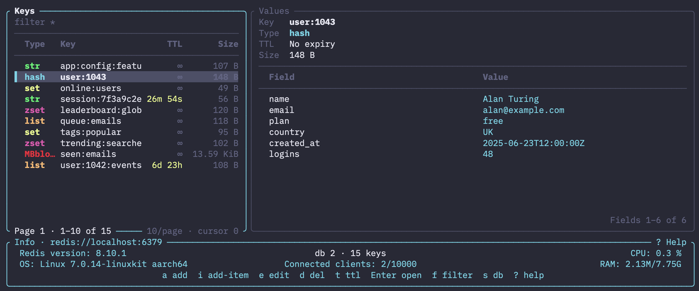

<p align="center">

</p>

# redis-rover

A Redis terminal-ui client written in rust 🦀

`redis-rover` (`rrover`) is a keyboard-driven TUI client for Redis. It lets you browse keyspaces, inspect and edit values, filter by pattern, and monitor server metrics — all from the terminal. Built with [ratatui](https://github.com/ratatui-org/ratatui) and powered by async I/O via Tokio.



**Features:**

- Browse and filter Redis keys with type-colored badges; module types (`json`, `stream`, `MBbloom--`, ...) show their real name
- Paginate through large keyspaces via SCAN, and through large values page by page (no `HGETALL` freezes). A page turn costs the same on page 1 and page 10,000, even with 10M keys swept
- Sort the key list by name, type, TTL or size, show only some types, or browse it as a prefix tree (`user:` → `user:1:`); load the whole keyspace in the background (`Shift-a`) and jump back to the open key (`g o`)
- View strings, lists, sets, hashes and sorted sets; add, edit and delete keys and items, with a confirm step on delete
- RedisJSON documents pretty-printed; a document above 1 MiB opens as a preview (its top-level fields with type and size, or the first 100 items) instead of freezing the pane
- Switch between logical databases (`s`) and see the key count of the current one
- `--read-only` mode for browsing production safely
- TLS (`rediss://`), including private CAs and mutual TLS
- Live metrics dashboard (`m`): ops/sec, memory, CPU, network, hit rate and clients charts, pause/reset, cluster summary
- Pub/Sub tab (`b`): subscribe to channels and patterns, a live log you can pause, message detail with pretty JSON, publish, per-subscription stats and notifications that don't spam
- Fully configurable key bindings, colors, and styles via a config file (JSON5, JSON, YAML, TOML, INI)

---

## Installation

**From crates.io:**

```bash
cargo install redis-rover --locked
```

Requires Rust 1.97 or newer.

**Prebuilt binaries** for macOS (x86\_64, arm64), Linux (x86\_64, aarch64), and Windows are available on the [GitHub releases page](https://github.com/danik-tro/redis-rover/releases).

---

## Usage

```bash
rrover                 # localhost:6379
rrover prod            # a profile from your config
rrover -u redis://10.0.0.5:6379
```

With no flags, `rrover` connects to `$REDIS_URL` if it is set, else to `localhost:6379`. Use `-u/--url` to pick a server, a [profile](#profiles) to keep servers in the config, and `--token` to type a password without it showing up in your shell history.

| Flag | Meaning |
|---|---|
| `PROFILE`, `--profile <NAME>` | Connect with a profile from the config. See [Profiles](#profiles). |
| `-u, --url <URL>` | Redis URL. A path picks the starting DB, e.g. `redis://localhost:6379/3`. |
| `--db <N>` | Starting DB; overrides the URL path. |
| `--token` | Prompt for the password (input is hidden). |
| `--read-only` | Block every write. Always wins. See [Read-only mode](#read-only-mode). |
| `--writable` | Start writable on a `prod` or `unknown` server, which start read-only. See [Environments](#environments). |
| `--print-target` | Print where `rrover` would connect, and where each setting came from, then exit. Opens no connection. |
| `--probe` | Connect, print a short report (PING, server version, role, cluster, RESP3, live updates), then exit. |
| `--tls-ca`, `--tls-cert`, `--tls-key`, `--insecure` | TLS options. See [TLS](#tls). |
| `-t, --tick-rate <FLOAT>` / `-f, --frame-rate <FLOAT>` | Ticks and frames per second. Default 4. A frame is drawn only when something on screen changed, so an idle key list redraws a few times a minute. |

Each setting is taken from the first place that sets it:

| Setting | Order |
|---|---|
| URL | `--url` > profile `url` > `$REDIS_URL` > `redis://localhost:6379` |
| DB | `--db` > profile `db` > the URL path > 0 |
| TLS files | each `--tls-*` flag > profile `tls` |
| Password | `--token` > profile `password_command` > the URL |
| Environment | profile `environment` > inferred from the host |
| Read-only | `--read-only` > `--writable` > profile `read_only` > the environment's default |

```console
$ rrover prod --print-target
profile     prod
target      rediss://redis.example.com:6380                     (profile prod)
db          0                                                   (default)
tls         on, verified with the bundled roots                 (url)
user        default
password    from `op read op://vault/redis/password` (not run)  (password_command)
environment prod                                                (profile prod)
read-only   yes                                                 (environment default)

$ rrover --probe
target    redis://localhost:6379
PING      PONG (1.9 ms incl. connect)
server    Redis 7.4.1 (standalone)
role      master
cluster   no
RESP3     yes
live      tracking
```

`--probe` exits 0 even when the server is older than 6.0 (`RESP3: no`). It exits 1 if it can't connect. An unknown profile, a failing `password_command` or an invalid config file exits with code 3.

### Profiles

Keep the servers you use in the `profiles` section of your [config](#configuration), then connect with `rrover <name>` (or `--profile <name>`):

```json5
{
  "profiles": {
    "local": { "url": "redis://localhost:6379" },
    "staging": {
      "url": "redis://staging-cache.internal:6379",
      "environment": "staging",
      "db": 2,
    },
    "prod": {
      "url": "rediss://default@prod-cache.example.com:6380",
      "environment": "prod",
      "password_command": "op read op://vault/redis-prod/password",
      "tls": { "ca": "~/certs/prod-ca.pem" },
    },
  },
}
```

| Field | Meaning |
|---|---|
| `url` | Redis URL. `--url` still wins. |
| `environment` | `local`, `staging`, `prod` or `unknown`. Inferred from the host when unset. |
| `db` | Starting DB. `--db` still wins. |
| `read_only` | `true` / `false` overrides the environment's default. |
| `password_command` | A shell command that prints the password, e.g. `op read op://…` (1Password), `pass show redis/prod`, or `security find-generic-password -s redis-prod -w` (macOS Keychain). |
| `tls` | `ca`, `cert`, `key` (paths, `~` allowed) and `insecure`, like the `--tls-*` flags. Each flag still wins. |

`password_command` runs with `sh -c` (`cmd /C` on Windows) before the TUI starts. Its output, minus one trailing newline, becomes the password. It is never logged or shown, and `--print-target` doesn't run it. If the command fails, `rrover` prints its stderr and exits with code 3.

### Environments

Every connection has an environment. It sets how much protection you get:

| Environment | Starts | Write preview | Typed confirm on key delete |
|---|---|---|---|
| `local` | writable | per `safety.preview` | no |
| `staging` | writable | per `safety.preview` | no |
| `unknown` | **read-only** | per `safety.preview` | no |
| `prod` | **read-only** | always, for every write | yes |

A profile sets it with `environment`. Without one, a loopback host (`localhost`, `127.0.0.1`, `::1`) or a unix socket is `local`, and any other host is `unknown`. The footer shows the environment as a badge (`LOCAL`, `PROD · RO`, …), and a line in its colour runs along the top of the screen. You can change the colours with `colors.env_local`, `env_staging`, `env_prod` and `env_unknown` in your config. `prod` is red.

> **SSH tunnels:** a tunnel to production on `localhost:6380` looks local, so it is inferred as `local` and starts writable. Use a profile with `"environment": "prod"` for it.

**Write preview.** Before a write is sent, a popup shows the exact Redis commands, quoted the way `redis-cli` prints them, e.g. `HSET "user:1" "name" "Ada"`. Writes that take several commands show all of them, e.g. `SREM` + `SADD` to replace a set member. Long values are cut, e.g. `"…"…(2.1 KiB more)`. Press `y` to run it, or `n` / `Esc` to cancel. The `safety.preview` setting picks which writes are previewed: `"writes"` (the default, every write), `"destructive"` (deletes only) or `"off"`. With `"off"`, deleting a key or an item still asks "Delete …?". On `prod`, every write is previewed whatever the setting.

```json5
{ "safety": { "preview": "destructive" } }
```

**Typed confirm.** On `prod`, deleting a key asks you to type its name (or `delete` for names longer than 40 characters) into the popup. `Enter` deletes only once the name matches.

### Read-only mode

```bash
rrover -u rediss://prod-cache:6379 --token --read-only
```

In read-only mode every write is refused: add, edit, delete, TTL changes and publish. The UI shows a notice instead of opening the edit form, the footer badge adds `· RO` and hides the write keys, and the background runner rejects any write that still gets through. `prod` and `unknown` servers start read-only. `--read-only` forces it for any server, and `--writable` lifts the default for one run.

`Shift-r` toggles read-only during the session. On `prod`, turning it off asks first ("Allow writes to PROD?"). The runner's check follows the toggle.

### Sorting, type filter and tree view

Keys come in SCAN order by default. Every view below works over the keys loaded so far, and the key list says how many that is.

- **Sort** (`o`): a menu picks SCAN order (`x`), key (`k`), type (`t`), TTL (`l`) or size (`s`); picking the active column again reverses it. Sorting by type, TTL or size fills in the metadata of keys that were never on a page in the background (the filter row shows `size 41k/120k` while it runs). Keys still unknown sort last.
- **Type filter** (`Shift-t`): a checklist of types (`Space` toggles, `Enter` applies). One type uses `SCAN … TYPE` on Redis 6+, otherwise the types are checked on the client.
- **Tree view** (`v`): keys are grouped at `keyspace.separator` (`:` by default), e.g. `▸ user: (3)`. `→` / `←` unfold and fold a group, `Enter` on a group toggles it and on a key opens it.
- **Load all** (`Shift-a`): loads the rest of the keyspace in the background, with a counter on the key list's bottom border (`loading 1.2M keys… Esc to stop`). `Esc` stops it and keeps what was loaded. Above 2M keys it asks first, with an estimate of the memory it needs.
- **Go to the open key** (`g o`): moves the cursor back to the last key opened with `Enter`, unfolding its groups. If the filter hides it, it asks before clearing the filter; if it isn't loaded yet, it loads keys until it shows up.

The sort, type filter and tree stay on after `r` and after switching DBs.

### Live updates

The open key follows changes made by other clients. When `HSET user:1 name Bob` runs elsewhere, the value pane shows `Bob` without a keypress, and the rows that changed are highlighted for 1.5 s. The page, the cursor and the scroll position stay where they were.

The value pane's title says how the key is followed:

- `● live`: on Redis 6+ (RESP3), `rrover` opens one extra connection with `CLIENT TRACKING ON OPTIN NOLOOP` and reads the open key on it again after every change, so the server pushes the next change too. A change shows up in milliseconds.
- `◌ polling 2s`: servers without RESP3 (Redis 5 and older), or that refuse `CLIENT TRACKING` (some proxies and managed services), are polled every `live.poll_interval_ms` instead. Each check is one pipeline: `TYPE` + `PTTL` + `DUMP` for keys up to 64 KiB, otherwise the visible page. The value is fetched again only when that changed. Polling pauses on the dashboard and Pub/Sub tabs.
- `✕ not live (reason)`: the connection was lost (`reconnecting`, retried with backoff up to 30 s), or `live.mode = "tracking"` on a server that can't track. After a reconnect the key is fetched again, so a change made in the gap still shows.

If another client deletes the key, or its TTL runs out, the last value stays on screen, dimmed, with `key deleted · 14:22:07` (or `key expired · …`) below it. The cursor doesn't move. If the key is created again, it is shown again.

Only the open key is followed; the key list still needs `r` to show new or removed keys. `rrover --probe` prints what a server supports (`live      tracking`, or `live      polling 2s (no RESP3)`).

To choose the mode, or turn it off:

```json5
{
  "live": {
    "mode": "auto",          // auto | tracking | poll | off
    "poll_interval_ms": 2000, // at least 250
  },
}
```

`off` opens no extra connection and the title shows nothing about liveness.

### Databases

Press `s` to open the DB picker. Move with `j`/`k` (or the arrow keys), or type the DB number, then press `Enter`. The footer shows the current DB and its key count, e.g. `db 3 · 120 keys`. You can also start on a DB with the URL path (`redis://host:6379/3`).

### RedisJSON

JSON keys show their document pretty-printed and coloured, like JSON strings. A document larger than `keyspace.json_preview_bytes` (1 MiB by default, measured with `MEMORY USAGE`) isn't read whole. The pane shows a preview instead:

- an object lists its top-level fields with their type and size, 100 per page (`n`/`p`). `Enter` on a field opens it, and the same limit applies again, so a large field opens as its own preview. `Esc` goes back one level.
- an array shows its first 100 items.
- any other value shows only its type and size.

The footer reads e.g. `14.21 MiB preview · fields 1–100 of 50,000 · n/p page · Enter opens`. `y` still copies the whole document, and asks first above 10 MiB. Previews use `$` paths and need RedisJSON 2 or later. With RedisJSON 1.x a document under the limit opens as usual, and a larger one shows only its size.

### Cluster

In cluster mode `rrover` connects to a single node. SCAN only sees that node's keys, so the key list is partial. A warning banner above the key table says so, and the footer key count reads `(this node)`. Cluster mode has only DB 0, so the DB picker is disabled. Full cluster browsing is planned after 0.1.0.

### Pub/Sub

Press `b` (from the keyspace or the dashboard) to open the Pub/Sub tab. `b` or `Esc` goes back.

- **Subscribe**: `a` opens a one-field popup. Text with `*`, `?` or `[` subscribes to a pattern (`PSUBSCRIBE`), anything else to a channel; `Tab` flips the kind. The left list also shows the server's other channels (`PUBSUB CHANNELS` with subscriber counts, `r` refreshes them); `Enter` on one subscribes to it. `d` unsubscribes, `c` clears the messages and stats.
- **Log**: the right pane shows the selected subscription's messages (time, concrete channel, one-line preview; binary payloads as `[binary N B]` plus hex). `Tab` moves the focus between the list and the log. The log follows the newest message; `Space` or `k` pauses it, and the title counts what arrived since (`paused · +128 new`). `Space` again, or `j` past the last row, follows again. Each subscription keeps the last 1,000 messages (8 MiB): if the paused rows are evicted, the view moves to the oldest message still kept.
- **Detail**: `Enter` in the log opens the message: channel, pattern, time, size (and `truncated (original …)` when it was cut at 64 KiB), and the payload in the same viewer as string values: JSON pretty-printed, `w` wrap, arrows pan, binary as a hex dump. `Esc` closes it.
- **Copy**: `y` copies the selected message's payload (binary as hex; the toast says `truncated` when the stored payload was cut), `Shift-y` its channel.
- **Stats** under the log: message count, bytes, average and largest size, rate over the last second and minute, time of the last message, and for patterns the five busiest channels.
- **Publish**: `Shift-p` opens a popup with a channel (prefilled from the selection) and a multi-line payload; `Ctrl-s` sends, and a toast says how many subscribers got it. Disabled with `--read-only`.
- **Notifications**: off by default, `Shift-n` toggles them per subscription. The first message toasts, later ones only bump the unread badge (per subscription, and `PubSub N` in the footer outside the tab) until the subscription has been quiet for 30 s. A subscription above 10 msg/s for 10 s is muted (`🔕`) until you press `Shift-n` again.

Subscriptions use their own connection, keep collecting while you're in other views, and resubscribe after a lost connection (the log marks the gap). They last for the session only. In cluster mode `PUBSUB CHANNELS` lists the connected node's channels only. Buffer sizes and notification thresholds are set in the `pubsub` section of the config.

### TLS

Use a `rediss://` URL to connect over TLS. Server certificates are checked against the bundled Mozilla root certificates, so most managed services need no extra flags.

```bash
# Public CA (ElastiCache, Upstash, Azure, ...)
rrover -u rediss://my-cache.example.com:6379 --token

# Private CA
rrover -u rediss://redis.internal:6379 --tls-ca ca.pem

# Mutual TLS (client certificate)
rrover -u rediss://redis.internal:6379 --tls-ca ca.pem --tls-cert client.crt --tls-key client.key

# Skip certificate checks (local or dev servers only)
rrover -u rediss://localhost:6379 --insecure
```

| Flag | Meaning |
|---|---|
| `--tls-ca <PATH>` | PEM CA bundle used to verify the server. Replaces the bundled root certificates. |
| `--tls-cert <PATH>` / `--tls-key <PATH>` | PEM client certificate and private key for mutual TLS. Must be given together. |
| `--insecure` | Do not verify the server certificate. Cannot be combined with `--tls-ca`. |

The TLS flags only work with `rediss://` URLs.

| Provider | URL | Extra flags |
|---|---|---|
| AWS ElastiCache / MemoryDB (in-transit encryption) | `rediss://<endpoint>:6379` with `--token`, or `rediss://<user>:<password>@<endpoint>:6379` for ACL users | none |
| Upstash | `rediss://default:<password>@<name>.upstash.io:6379` | none |
| Azure Cache for Redis | `rediss://:<access-key>@<name>.redis.cache.windows.net:6380` | none |
| Redis Cloud | `rediss://default:<password>@<host>:<port>` | `--tls-ca redis_ca.pem`, and `--tls-cert`/`--tls-key` if mutual TLS is on |
| GCP Memorystore | `rediss://<ip>:6378` | `--tls-ca server-ca.pem` |
| Self-hosted with a self-signed certificate | `rediss://<host>:<port>` | `--tls-ca ca.pem` |

---

## Keybindings

Press `?` in the app for the full list. Defaults:

**Keyspace**

| Key | Action |
|---|---|
| `j` / `k` | Scroll down / up |
| `n` / `p` | Next / previous page (of keys, or of the open value) |
| `Enter` | Open the selected value (or a field of a JSON preview) / confirm |
| `Esc` | Close popup / leave the value pane / stop loading keys |
| `f` / `l` | Set / clear the filter pattern (glob, e.g. `user:*`) |
| `o` | Sort by key, type, TTL or size |
| `Shift-t` | Show only some types |
| `v` | Tree view (`←` / `→` fold and unfold) |
| `Shift-a` | Load all keys (`Esc` stops) |
| `g o` | Go to the open key |
| `r` | Refresh keyspace |
| `a` | Add a new key |
| `i` | Add an item to the open collection |
| `e` | Edit the value, or the selected item |
| `d` | Delete the key, or the selected item (shows the command first) |
| `t` | Set TTL |
| `s` | Switch database |
| `m` | Open the metrics dashboard |
| `b` | Open Pub/Sub |
| `Shift-r` | Toggle read-only (asks first on `prod`) |
| `?` | Toggle help |
| `Ctrl-c` | Quit |

**Dashboard**

| Key | Action |
|---|---|
| `m` / `Esc` | Back to the keyspace |
| `Space` | Pause / resume |
| `r` | Reset history |
| `Tab` / `→` / `l` | Next chart |
| `Shift-Tab` / `←` / `h` | Previous chart |
| `a` | Show all charts |
| `b` | Open Pub/Sub |
| `Shift-r` | Toggle read-only |
| `?` | Toggle help |

**Pub/Sub**

| Key | Action |
|---|---|
| `b` / `Esc` | Back (`Esc` closes the message detail first) |
| `j` / `k` | Move in the focused pane (`k` in the log pauses it) |
| `Tab` | Switch focus between the list and the log |
| `Space` | Pause / follow the log |
| `Enter` | List: subscribe to a server channel. Log: open the message |
| `y` / `Shift-y` | Copy the message payload / its channel |
| `w`, `←` / `→` | Wrap / pan the message detail |
| `a` | Add a subscription (channel or pattern) |
| `d` | Unsubscribe |
| `c` | Clear messages and stats |
| `Shift-p` | Publish |
| `Shift-n` | Toggle notifications |
| `r` | Refresh server channels |
| `Shift-r` | Toggle read-only |

In the write preview, `y` runs the write and `n` / `Esc` cancels. In the typed confirm on `prod`, `Enter` deletes once the key name matches.

### Configuration

Key bindings, environment colors, styles, limits, [profiles](#profiles) and the [write preview](#environments) can be set in `config.json5` (or `.json`, `.yaml`, `.toml`, `.ini`) in the config directory. `rrover --version` prints where that is; set `REDIS_ROVER_CONFIG` to use another directory. See [`.config/config.json5`](.config/config.json5) for the defaults and their format.

For example, to preview RedisJSON documents only above 4 MiB:

```json5
{
  "keyspace": { "json_preview_bytes": 4194304 },
}
```

---

## Development

**Prerequisites:**

- Rust 1.97 (the toolchain is pinned via `rust-toolchain.toml` — `rustup` will pick it up automatically)
- A running Redis instance on `localhost:6379`
- Docker, for the integration tests only

**Common commands:**

```bash
# Build
cargo build

# Run
cargo run

# Run tests (no Docker or Redis needed)
cargo test

# Integration tests against a real Redis 7 in Docker
cargo test -- --ignored --test-threads=1

# Golden frames: rewrite tests/golden/*.txt after an intended UI change
UPDATE_GOLDEN=1 cargo test --test golden

# Benchmarks (no Redis needed)
cargo bench
scripts/bench.sh --quick    # writes target/bench-summary.md; compare with benches/baseline.md

# Lint
cargo clippy --all-targets --all-features -- -D warnings -W clippy::all -W clippy::pedantic

# Check formatting
cargo fmt --check
```

The integration tests (`tests/integration.rs`) start `redis:7-alpine` with [testcontainers](https://crates.io/crates/testcontainers), one container per test, so they don't touch your own Redis. They cover SCAN paging (including paging to page 1,000 over 1M keys, each page under 100 ms), DB switching, `--read-only`, value edits, Pub/Sub reconnects and TLS, and run in CI on every push, PR and nightly.

If a change touches the keyspace or rendering, run the benches before and after and compare with `benches/baseline.md` (the sol 01 baseline plus an "After sol 02" section). `scripts/bench.sh` without `--quick` also runs the 10M-key case, which takes a few minutes and about 2 GB of RAM.

Golden-frame tests (`tests/golden.rs`) draw the main screens from fixed data and compare their text with `tests/golden/<name>.txt`. A UI change makes them fail with the rows that differ; if the change is intended, rewrite the files with `UPDATE_GOLDEN=1` and review their diff in the PR.

The crate has a library target only so benches and tests can reach internal types. It is not a public API.

**Pre-commit hooks:**

This repo uses [prek](https://github.com/j178/prek) (a Rust-based drop-in for the `pre-commit` framework) to run `cargo fmt` and `cargo clippy` before every commit.

```bash
# Install prek (macOS)
brew install prek

# Or via cargo
cargo install prek

# Install the git hooks
prek install

# Run all hooks manually
prek run --all-files
```

---

## Contributing

1. Fork the repository and create a branch from `master`
2. Install the pre-commit hooks (`prek install`) — they enforce formatting and lints locally
3. Make your changes and ensure `prek run --all-files` passes
4. Open a pull request — CI will run `cargo fmt`, `cargo clippy`, `cargo build`, `cargo nextest` and the Docker integration tests automatically

Please keep commits focused and PRs scoped to a single concern.
