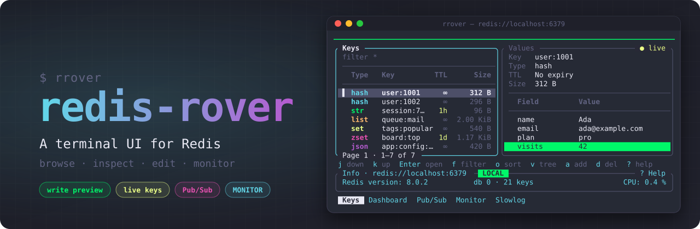

<p align="center">

</p>

# redis-rover

[](https://crates.io/crates/redis-rover)
[](https://github.com/danik-tro/redis-rover/actions/workflows/ci.yml)
[](https://github.com/danik-tro/redis-rover/blob/master/LICENSE)

**A keyboard-driven Redis client for the terminal: browse millions of keys, and see every write before it runs.**

`rrover` lets you browse keys, read and edit values, and watch the server live, all in one terminal window. It also works in an SSH session with no GUI.

```bash
curl -LsSf https://github.com/danik-tro/redis-rover/releases/latest/download/install.sh | sh
rrover
```


## Why rrover

**You see every write before it runs.** By default, before a write is sent, a popup shows the exact commands, quoted as `redis-cli` prints them, and you press `y` to run them. Every connection has an environment (`local`, `staging`, `prod` or `unknown`), set in a profile or inferred from the host. A server that isn't on your machine starts **read-only** until you turn writes on, and on a `prod` connection deleting a key means typing its name. A coloured line along the top of the screen shows which environment you're in.

**It doesn't freeze on big data.** Keys are read with `SCAN`, never `KEYS`, and large values are read a page at a time, never one huge `HGETALL`. A page turn costs the same on page 1 and on page 10,000, even with 10 million keys loaded. A large RedisJSON document opens as a preview of its fields.

**It shows changes as they happen.** The open key updates when another client changes it, and the changed rows are highlighted. On Redis 6+ the server pushes the change; on older servers rrover polls. If the key is deleted or expires, the screen says so.

**It replaces several tools.** The key browser, a metrics dashboard, Pub/Sub with a live log and publishing, a `MONITOR` tail with sampling under load, and the Slowlog. Each is one or two keys away.

**It works with the Redis you already run.** Redis 5 to 8, Valkey, KeyDB, Dragonfly and Redis Stack. Cluster, Sentinel, TLS and mutual TLS, with setup notes for ElastiCache, Upstash, Azure, Redis Cloud and Memorystore. It is a single binary, and it still works in a narrow SSH window.

**You can make it yours.** Rebind any key, pick a theme or write your own, and keep your servers in named profiles, with passwords read from 1Password, `pass` or the Keychain. When you come back to a server, rrover restores the filter, sort, open key and subscriptions you left.

## Install

| Method | Command |
|---|---|
| Install script (macOS, Linux) | `curl -LsSf https://github.com/danik-tro/redis-rover/releases/latest/download/install.sh \| sh` |
| Homebrew (macOS, Linux) | `brew install danik-tro/tap/rrover` |
| Cargo (Rust 1.97+) | `cargo install redis-rover --locked` |
| Windows (experimental) | `irm https://github.com/danik-tro/redis-rover/releases/latest/download/install.ps1 \| iex` |

The install script picks the right archive (a static musl build on Linux) and checks its sha256. Prebuilt binaries for macOS, Linux and Windows are on the [releases page](https://github.com/danik-tro/redis-rover/releases).

## Quick start

```bash
rrover                                  # localhost:6379, or $REDIS_URL
rrover -u rediss://cache.example.com:6380 --token   # asks for the password
rrover staging                          # a profile from your config
```

| Key | What it does |
|---|---|
| `j` / `k`, `Enter` | Move, open a key |
| `f` | Filter keys by pattern (`user:*`) |
| `v` | Show the keys as a prefix tree |
| `o` | Sort by name, type, TTL or size |
| `a`, `e`, `d` | Add, edit, delete (you see the commands first) |
| `s` | Switch database |
| `m`, `b`, `g m`, `g s` | Dashboard, Pub/Sub, MONITOR, Slowlog |
| `?` | Every key on the current screen |
| `Ctrl-c` | Quit |

A hint bar at the bottom always shows the keys for the current screen. All the defaults are in [docs/keybindings.md](https://github.com/danik-tro/redis-rover/blob/master/docs/keybindings.md).

## Features

**Browse**
- Paging through any keyspace with `SCAN`, with a filter that counts matches as you type
- Sort by name, type, TTL or size; show only some types; browse as a prefix tree
- Strings, lists, sets, hashes, sorted sets, streams (with consumer groups) and RedisJSON, pretty-printed
- Load the whole keyspace in the background, and jump back to the key you had open
- Logical databases, with key counts

**Edit safely**
- Add, edit and delete keys and items; rename, copy (to another DB too) and set TTLs (`+10m`, `2h30m`, `persist`)
- Mark keys and delete them in one go with `UNLINK`
- Edit a value or a whole collection in `$EDITOR`; only what you changed is written, in one `MULTI`
- A preview of the commands, read-only defaults and typed confirms, tuned per environment

**Watch the server**
- The dashboard: ops/sec, memory, CPU, network, hit rate and clients, per node on a cluster
- Pub/Sub: channels, patterns and sharded channels, a pausable log, JSON message detail, publishing, and notifications that don't spam
- `MONITOR` with a filter, pause and sampling under load; the Slowlog sorted by time or duration

**Fit your terminal**
- Mouse support: click, double-click, wheel, tabs and popup buttons
- `dark`, `light`, `high-contrast` and `monochrome` themes, or your own; truecolor, 256 colours, 16 colours and `NO_COLOR`
- A layout that adapts below 120 and 70 columns
- Config in JSON5, JSON, YAML, TOML or INI

Each feature is explained in the **[guide](https://github.com/danik-tro/redis-rover/blob/master/docs/guide.md)**.

## Compatibility

Every release is tested against these servers in Docker. When a server lacks a feature, rrover uses a fallback, so older servers keep working. The [full table](https://github.com/danik-tro/redis-rover/blob/master/docs/compatibility.md) lists every feature and its notes.

<!-- compat:start (generated by scripts/compat-report.py) -->
| Server | Works | Fallback | Fails |
|---|---|---|---|
| redis-5 (5.0.14) | 8 of 12 | Copy, Type filter, Live, Streams | – |
| redis-6.0 (6.0.20) | 10 of 12 | Copy, Streams | – |
| redis-6.2 (6.2.21) | 11 of 12 | Streams | – |
| redis-7.2 (7.2.11) | 13 of 13 | – | – |
| redis-8 (8.12.0) | 14 of 14 | – | – |
| valkey-8 (valkey 8.1.12 (reports redis 7.2.4)) | 13 of 13 | – | – |
| keydb (6.3.4) | 11 of 12 | Streams | – |
| dragonfly (df-v2.1 (reports redis 7.4.0)) | 13 of 14 | Copy | – |
| redis-stack (7.4.7) | 14 of 14 | – | – |
<!-- compat:end -->

## Performance

With 10 million keys loaded, a page turn deep in the list takes about 4 µs of rrover's own time. Drawing the key table takes about 0.13 ms a frame. Both are criterion benches without a network, so the network adds its own round trip on top. The numbers, the machine and the benches are in the [guide](https://github.com/danik-tro/redis-rover/blob/master/docs/guide.md#performance).

## Configuration

The defaults are built in, so the config only needs what you change. `rrover --version` prints where the config lives. Here are a profile and a theme:

```json5
// ~/.config/redis-rover/config.json5 on Linux
{
  "profiles": {
    "staging": {
      "url": "rediss://default@staging-cache.example.com:6380",
      "environment": "staging",
      "password_command": "op read op://vault/redis-staging/password",
    },
  },
  "ui": { "theme": "light" },
}
```

The [configuration guide](https://github.com/danik-tro/redis-rover/blob/master/docs/guide.md#configuration) covers the folder on each OS, key bindings, themes, timeouts and limits.

## Contributing

Bug reports, ideas and pull requests are welcome. [CONTRIBUTING.md](https://github.com/danik-tro/redis-rover/blob/master/CONTRIBUTING.md) covers the build, the tests and the hooks, and everyone taking part agrees to the [code of conduct](https://github.com/danik-tro/redis-rover/blob/master/CODE_OF_CONDUCT.md). Changes are listed in the [changelog](https://github.com/danik-tro/redis-rover/blob/master/CHANGELOG.md).

Built with [ratatui](https://github.com/ratatui-org/ratatui) and [Tokio](https://tokio.rs). MIT licensed.
